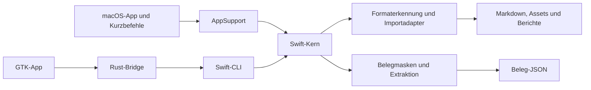

# Architektur

Die macOS-App, die GTK-App und die CLI verwenden denselben Swift-Kern für
Dokumentkonvertierung und Belegextraktion. Die fachlichen Module bleiben frei
von SwiftUI. Fastra verwendet den veröffentlichten
[CLI-Vertrag](FASTRA-CONTRACT.md).

## Zuständigkeiten

| Modul | Aufgabe |
| --- | --- |
| `PoorMansTextCore` | Formaterkennung, Konvertierungsaufträge, Stapelplanung, Importadapter, Ausgabe, Diagnosen, Profile und Belegextraktion |
| `PoorMansTextCLI` | Argumente, Ausgabemodi, JSON-Vertrag und Exit-Codes |
| `PoorMansTextAppSupport` | macOS-Konvertierungssitzung, Einstellungen, Vorschauaufbereitung sowie Adapter für AppKit, Finder-Dienste und Kurzbefehle |
| `PoorMansTextApp` | SwiftUI-Ansichten, Präsentation von Dialogen, Bedienung von Vorschau und Belegeditor |
| `linux/app` | GTK-Ansichten, Auswahlzustand, Profile, Zwischenablage und Belegeditor |
| `linux/bridge` | Typisierte Auftrags- und Ergebnisübergabe, Prozessaufsicht, Begrenzung und Abbruch der lokalen CLI |

SwiftPM löst Sparkle und AppSupport auf macOS auf. Unter Linux liefern
FoundationXML, zlib und Swift Crypto die benötigten Funktionen für Parser und
Fingerabdrücke. GTK und die Bridge kommunizieren über die CLI. Der gemeinsame
Kern wird über SwiftPM gebaut.

## Konvertierung

1. **Eingaben erfassen.** Der `InputEnumerator` behandelt Dateien und
   Ordnerpakete als einzelne Eingaben. In gewöhnlichen Verzeichnissen sammelt
   er unterstützte Dokumente in stabiler Reihenfolge. Versteckte Einträge,
   Symlinks im Suchbaum und frühere Ergebnisordner werden übersprungen.
2. **Format erkennen und Quelle binden.** `DocumentConverter` vergleicht die
   Befunde der Adapter. Der sichtbare Name kann für die Formaterkennung zählen.
   Derselbe verifizierte Quellpfad wird anschließend für Import und Zielschutz
   verwendet. Inhaltsauswahlen aus einer Übersicht können an die Quellbytes
   gebunden werden.
3. **Privat konvertieren.** Der Arbeitsbereich liegt neben dem geplanten Ziel.
   Der Adapter erhält getrennte Pfade für Arbeitsdateien und
   Veröffentlichung. Dateigröße, Parserstruktur, Medien und Hilfsprozesse
   haben eigene Grenzen. Erlaubte Ressourcen sind lokal und auf den
   Importkontext begrenzt.
4. **Ergebnis vorbereiten.** Markdown und Assets werden auf Vollständigkeit
   geprüft. Frontmatter, Textbundle-Struktur und Sammlungslinks werden vor
   der Veröffentlichung ergänzt. Eine Quellzuordnung kann Textbereiche mit
   Quellpositionen verbinden. Der Bericht verwendet portable Pfade.
5. **Ergebnis veröffentlichen.** Ein vollständiger Ergebnisordner wird am
   endgültigen Ziel veröffentlicht. Vorhandene Ausgabe und Quelle bleiben
   erhalten. Auf Linux hält die Veröffentlichung Zielverzeichnis und
   Staging über Deskriptoren und benutzt `renameat2(RENAME_NOREPLACE)`. Bei
   einem ausgetauschten Elternverzeichnis kann ein vollständiges Ergebnis
   am gehaltenen Ort zur Wiederherstellung verbleiben. Auf macOS wird die
   Zielprüfung vor dem Verschieben mit derselben verifizierten Quelle
   wiederholt.

`BatchConverter` bindet und prüft alle Quellen und Ziele vor dem Anlegen
gemeinsamer Ausgabeordner. Er begrenzt die Parallelität und sortiert Ergebnisse
in Eingabereihenfolge. Fortschrittsereignisse kennzeichnen aktive und bereits
fertige Arbeiten. Abbruch beendet offene Arbeiten und erhält vollständig
veröffentlichte Ergebnisse. Der `--stdout`-Pfad gibt ein einzelnes
Markdown-Dokument aus und räumt seinen temporären Ergebnisordner auch bei
einem Ausgabefehler auf.

[Berichte und Quellzuordnung](CONVERSION-REPORT.md) · [Diagnosen](DIAGNOSTICS.md) · [Profile](PROFILES.md)

### Importadapter

| Formatfamilie | Gemeinsamer Import und Plattformgrenze |
| --- | --- |
| DOCX und ODT | Geprüfte Pakete und Pandoc. DOCX-Kommentare und Textänderungen werden in einer privaten Kopie für den Import vorbereitet. |
| RTF und RTFD | Gemeinsame Unicode-Vorbereitung. macOS nutzt für RTFD Cocoa. Linux übernimmt verifizierte statische RTFD-Anhänge und verwendet den RTF-/Pandoc-Pfad. |
| DOC | macOS verwendet `textutil`. Linux verwendet isoliertes LibreOffice mit UNO. |
| Tabellen | Eingebaute OLE-/ZIP-Leser und ein gemeinsames Arbeitsmappenmodell für XLS, XLSX und ODS. Eingebaute CSV-/TSV-Erkennung und Textdarstellung. |
| Folien und Notebooks | Gemeinsame Foliensequenz für OOXML und ODP. Begrenzter JSON-Import für Notebook-Daten und vorhandene Ausgaben. |
| EPUB, HTML und Textformate | Lokale, geprüfte Referenzen und Pandoc, mit einer eigenen EPUB-Inhaltsübersicht und Auswahl. |
| Mail und Sammlungen | EML, EMLX und MSG über gemeinsame Mailmodelle. MBOX und ENEX können verknüpfte Markdown-Dokumente mit eigenen Anhängen erzeugen. |
| PDF und Rasterbilder | macOS nutzt PDFKit, ImageIO und Vision. Linux nutzt Poppler über Python/GI, libpng, lokale Rasterwerkzeuge und Tesseract. Die optionale strukturierte OCR hat eigene Plattform- und Runtime-Voraussetzungen. |

`DocumentConversionAdapter` meldet Formate, Container und Werkzeugbedarf. Der
Formatkatalog ergänzt das um lokale Verfügbarkeit. Parser und Adapter
behalten Quellreihenfolge und Originalkoordinaten, wo sie aus dem Format
eindeutig ermittelt werden können. Die Adapter melden bekannte Verluste
und Ersatzpfade als Diagnosen.

Der Markdown-Rewriter ändert belegte Zielbereiche bytegenau und verwendet
für unveränderte Bereiche die ursprünglichen Zeichen. Blockgrenzen,
unvollständige Backtick-Folgen, Escapes und Referenzdefinitionen werden
dabei ausdrücklich berücksichtigt. Die Markdown-Normalisierung verwendet
dieselbe Codeblock-Erkennung.

[PDF](PDF-IMPORT.md) · [Bilder](IMAGE-IMPORT.md) · [Tabellen](SPREADSHEET-IMPORT.md) · [Folien](PRESENTATION-IMPORT.md) · [Notebooks](NOTEBOOK-IMPORT.md) · [Sammlungen](COLLECTIONS.md) · [DOCX-Änderungen](DOCX-REVIEWS.md)

### Hilfsprozesse und Budgets

Die Konvertierung gibt Abbruch-Token, Fortschritt, Zeitlimits und erlaubte
Schreibbereiche an den Aufrufkontext weiter. Unter Linux startet Bubblewrap
den Hilfsprozess in privaten PID- und Netz-Namensräumen. Der Prozessguard
kontrolliert die Lebensdauer. pidfds bestätigen das Ende des Wrappers und
des Namensraums vor dem Löschen von Eingaben und Capture-Dateien. Gehaltene
Deskriptoren binden die erlaubten Lese- und Schreibpfade. Auf macOS bleiben
Werkzeuglaufzeit, Ausgabe und Prozessgruppe unter Aufsicht des Runners.

Für strukturierte Vision-OCR übergibt macOS die asynchrone Arbeit an einen
dedizierten Executor. Der synchrone Aufruf wartet bei Abbruch auf das
tatsächliche Ende, damit Gate und temporäre Dateien gültig bleiben. Die
Ergebnisprojektion und das gemeinsame Rendering prüfen Textdeckung und
Struktur. Ist die Struktur unsicher, kann die Standarderkennung mit
Diagnose übernehmen. [Strukturierte OCR](STRUCTURED-OCR.md)

## Bedienoberflächen

Auf macOS besitzt `ConversionSettings` die Konvertierungsoptionen und die
gespeicherten Standardwerte. Die Konvertierungssitzung führt aktive Aufträge,
Auswahl, Vorschau, Abbruch und Wiederholung. Profile lesen und ändern die
Einstellungen über denselben Speicherpfad. Die Ansicht hält jeweils den
aktiven Dialog oder das aktive Blatt mit den benötigten Daten.

GTK gliedert das Hauptfenster in Quellauswahl, Optionen, Aktionen und
Ergebnisanzeige. Die Bridge startet die CLI über einen privaten, begrenzten
Auftragskanal. Clipboard-Dateien auf Linux liegen in versiegelten memfds.
Quelle, Vorschau und Profilbindung verwenden dieselbe private Eingabe.
Auf macOS übernimmt AppSupport einen begrenzten Clipboard-Snapshot. Die
Konvertierung erfolgt danach über die normalen Adapter.

Die Vorschau zeigt gerendertes Markdown oder den Quelltext und begrenzte
lokale Assets. Für den Quellenvergleich müssen die Fingerabdrücke von
Quelle und Ergebnis übereinstimmen. Linux verwendet eine passive
CLI-Operation für Rasterausschnitte und überprüft den Transport vor der
Dekodierung. Die macOS-App verwendet ihren nativen Viewer. Die Zoomstufe
arbeitet mit vorhandenen Vorschaupixeln.

[Vorschau](MARKDOWN-PREVIEW.md) · [Quellenvergleich](SOURCE-COMPARISON.md) · [Zwischenablage](CLIPBOARD-IMPORT.md)

## Belegextraktion

Die Extraktion ist ein eigener Produktpfad im gemeinsamen Kern. Eine
JSON-Maske beschreibt Felder, Seiten und Bereiche in physischen Millimetern
im ungedrehten PDF-Seitenraum. PDFKit auf macOS und Poppler mit qpdf auf
Linux liefern eingebettete Wörter und Geometrie. Die Plattformeditoren
übersetzen sichtbare Auswahl und Rotation in dasselbe Maskenmodell.

Maske, erkannte Wörter und manuelle Korrekturen bleiben getrennt. Eine
Änderung der PDF-Bytes erfordert erneute Überprüfung der betroffenen Datei.
Im GTK-Editor nimmt ein ausdrückliches Neuladen deren neue Identität auf und
verwirft die zugehörigen Korrekturen. Maskenentwurf und Korrekturen anderer
PDFs bleiben erhalten. Die CLI und beide Apps verwenden denselben
Stapelauftrag. Beleg-JSON wird pro Ergebnis atomar am gewählten Ziel
veröffentlicht.

[Maskenformat, Fundstellen und Prüfstatus](RECEIPT-EXTRACTION.md)

## Prüfen und weiterentwickeln

Die Swift-Suite für gemeinsame Regressionen läuft auf beiden Systemen.
Apple-spezifische Tests liegen im Unterordner `Apple/` der Core-Tests,
Linux-spezifische im Linux-Testtarget. Reale Dokumente und unabhängige
Prüfer belegen Text, Referenzen, Originalbytes und Ausgabelayout.
GTK-Unit-Tests und Bridge-Integration laufen über `linux/test.sh`, mit
Xvfb für die GTK-Bedienproben.

[macOS-Build und Tests](BUILD-AND-TEST.md) · [Linux-Build und Paketierung](LINUX-BUILD.md) · [Distribution und Updates](SPARKLE-RELEASE.md)
