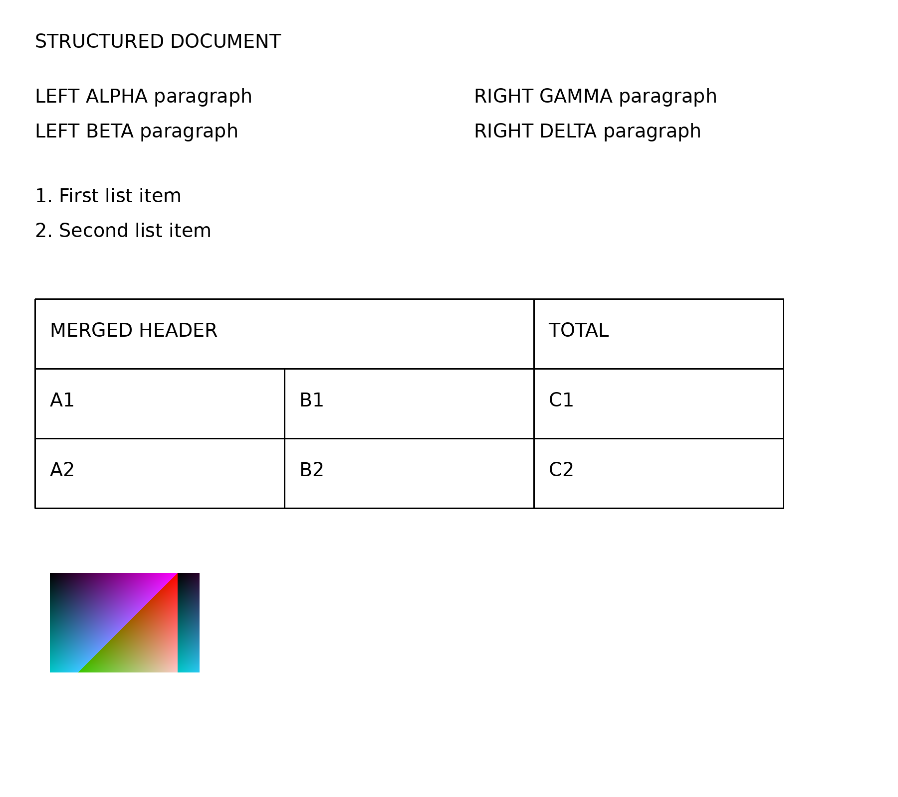

# structured

## OCR text

STRUCTURED DOCUMENT

LEFT ALPHA paragraph

LEFT BETA paragraph

1. First list item
2. Second list item

|  |  |  |
| --- | --- | --- |
| MERGED HEADER |  | TOTAL |
| Al | B1 | C1 |
| A2 | B2 | C2 |

RIGHT GAMMA paragraph

RIGHT DELTA paragraph
